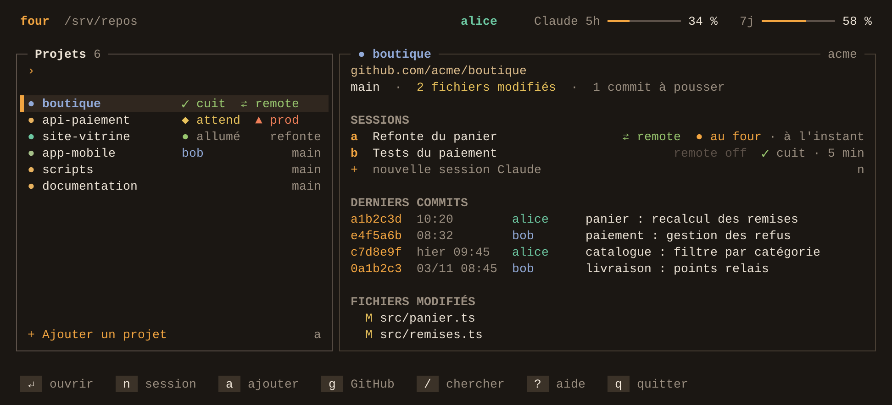

<div align="center">
  
  <h1>four</h1>
  <p><strong>Enfournez vos projets, Claude Code s'occupe de la cuisson.</strong></p>
</div>

`four` transforme un serveur Linux en atelier partagé. Connecté en SSH, vous tapez `four`, vous choisissez un projet et [Claude Code](https://code.claude.com/docs) démarre dedans. Il continue de travailler après votre déconnexion, et le menu vous dit quand c'est prêt.



- **Au four** : plusieurs sessions par projet, avec `✓ cuit` et `◆ attend` visibles depuis n'importe où.
- **En brigade** : qui a une tâche Claude en cours ou finie depuis moins de 5 minutes, et sur quel projet.
- **Garde-manger** : cloner, créer ou lier un repo GitHub sans quitter le menu.
- **Minuteur** : limites de l'abonnement Claude et état du Remote Control.

## four est-il fait pour vous ?

**Il vous faut :**

- une machine **Linux allumée en permanence**, joignable en SSH (un VPS, par exemple) ;
- les **droits `sudo`** sur cette machine, pour l'installation ;
- un **abonnement Claude** et un **compte GitHub** par personne ;
- un peu d'aisance dans un terminal. L'interface est en français.

Vous pouvez vous connecter depuis Windows, macOS ou Linux : seul le serveur doit être sous Linux.

**Passez votre chemin si :**

| Votre situation | Pourquoi |
|---|---|
| Vous voulez l'installer directement sur un Mac ou un PC Windows | `four` ne tourne que sous Linux |
| Vous n'avez pas `sudo` (hébergement mutualisé, serveur géré par un tiers) | L'installation crée un groupe et un dossier partagés |
| Vous travaillez seul, sur une seule machine, sans vous déconnecter | Claude Code seul vous suffit |
| Les membres de l'équipe ne doivent pas voir le code des autres | Tout le groupe peut lire et modifier tous les projets |
| Vous voulez un environnement isolé pour des personnes ou du code non fiables | `four` n'est pas un bac à sable : Claude agit avec les droits de votre compte |

## Installation

Ces commandes visent Ubuntu et Debian, sur processeur x86-64 ou ARM64. Sur une autre distribution, installez les mêmes paquets avec votre gestionnaire, puis adaptez la ligne `curl` à votre processeur.

**1. Installez `four`** sur le serveur :

```sh
sudo apt update && sudo apt install -y tmux git gh python3 curl
curl -fsSL -o four "https://github.com/Le-Fournil-Creatif/four/releases/latest/download/four-linux-$(dpkg --print-architecture)"
sudo install -m 755 four /usr/local/bin/four && rm four
sudo groupadd -f devs
sudo mkdir -p /srv/repos
sudo chgrp devs /srv/repos
sudo chmod 2775 /srv/repos
sudo usermod -aG devs "$USER"
```

**2. Configurez votre compte** avec `four setup`, puis suivez l'assistant :

| Étape | Ce qu'il se passe |
|---|---|
| Compte SSH | Collez votre clé publique, ou passez à la suite avec <kbd>Tab</kbd>. Si ce compte en a déjà une, l'étape est validée. |
| Accès projets | Déjà validé par l'étape 1. |
| GitHub | Un code s'affiche, à saisir sur github.com. |
| Identité git | Remplie depuis votre compte GitHub. |
| Claude | Installe Claude Code si besoin, puis vous connecte à votre compte Claude. |
| Notifications | Ajoute des hooks et une ligne d'état dans `~/.claude/settings.json`. Claude Code masque alors la plupart de ses rappels de raccourcis. |

**3. Enfournez votre premier projet :** tapez `four`, puis <kbd>a</kbd>. Partez d'un repo GitHub ou d'un nouveau projet. Claude démarre dedans.

## Inviter un collègue

Sur le serveur, créez son compte :

```sh
sudo adduser marie
sudo usermod -aG devs marie
```

Si votre serveur refuse les mots de passe en SSH, ajoutez aussi sa clé publique dans `/home/marie/.ssh/authorized_keys`. Marie se connecte ensuite et lance `four setup` : elle utilise son propre GitHub et son propre abonnement Claude.

## Aux fourneaux

Dans une session, appuyez sur <kbd>Ctrl</kbd>+<kbd>b</kbd>, relâchez, puis appuyez sur la touche suivante.

| Touches | Action |
|---|---|
| `four` | Ouvrir le menu (<kbd>?</kbd> pour l'aide) |
| <kbd>Ctrl</kbd>+<kbd>b</kbd> puis <kbd>Espace</kbd> | Ouvrir le menu par-dessus une session |
| <kbd>Ctrl</kbd>+<kbd>b</kbd> puis <kbd>d</kbd> | Revenir au menu, Claude continue de tourner |
| <kbd>Ctrl</kbd>+<kbd>b</kbd> puis <kbd>x</kbd> | Fermer la session |

## Le thermostat

Par défaut, Claude demande avant d'agir. Deux listes partagées changent ce comportement, avec un projet par ligne :

| Fichier | Effet |
|---|---|
| `/srv/repos/.four/auto` | Lance Claude avec `--dangerously-skip-permissions`, donc **sans aucune confirmation**. `*` vaut pour tous les projets. |
| `/srv/repos/.four/prod` | Affiche `▲ prod` et garde toujours les confirmations, même avec `*`. |

Ces listes valent pour toute l'équipe.

## En cas de pépin

| Symptôme | Solution |
|---|---|
| `Permission denied` dans `/srv/repos` | Reconnectez-vous en SSH pour activer le groupe `devs`. |
| `Ctrl-b` `Espace` ne fait rien | Ce raccourci ne marche que dans une session. Dans le menu, vous y êtes déjà. |
| Les jauges affichent `– %` | Validez « Notifications » dans `four setup`, puis envoyez un message à Claude dans une nouvelle session. Elles restent vides sans abonnement Claude ou si vous gardez votre propre ligne d'état. |

## Désinstaller

Vos projets restent dans `/srv/repos`.

```sh
tmux -L four kill-server      # ferme toutes vos sessions four
sudo rm /usr/local/bin/four
rm -rf ~/.cache/four
```

Retirez ensuite de `~/.claude/settings.json` les hooks `four _notify` et la ligne d'état `four _statusline`.

## Pour aller plus loin

<details>
<summary>Variables de configuration</summary>

Toutes sont facultatives :

| Variable | Rôle | Défaut |
|---|---|---|
| `FOUR_ROOT` | Dossier des projets | `/srv/repos` |
| `FOUR_OWNER` | Compte GitHub proposé en premier | aucun |
| `FOUR_HIDE` | Comptes à masquer dans l'équipe, séparés par des virgules | aucun |
| `FOUR_LEGACY` | Ancien dossier de projets (dépôts git seulement) | aucun |
| `FOUR_SOCKET` | Nom du serveur tmux | `four` |

</details>

<details>
<summary>Compiler depuis les sources</summary>

Avec Go 1.26 ou plus récent :

```sh
git clone https://github.com/Le-Fournil-Creatif/four.git
cd four
go build -o four ./cmd/four
sudo install -m 755 four /usr/local/bin/four
```

</details>

## Licence

[MIT](LICENSE). Projet indépendant, sans lien avec Anthropic.
